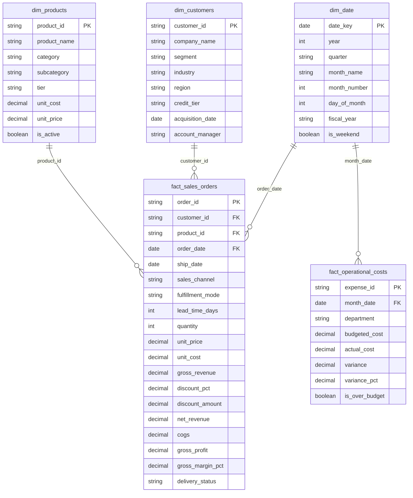

# Enterprise Business Performance Data Model Architecture

## 1. Architectural Overview & Star Schema
The enterprise decision intelligence system is built upon a Kimball-style dimensional star schema optimized for in-memory Power BI tabular engine (VertiPaq) performance, bidirectional filter safety, and sub-second query latency.

## 2. Table Cardinalities & Relationship Rules
1. **`dim_customers (1)` to `fact_sales_orders (*)`**:
   - Primary Key: `customer_id` -> Foreign Key: `customer_id`
   - Cross-filter direction: **Single** (Dimension filters Fact table)
   - Cardinality: **1 to Many**

2. **`dim_products (1)` to `fact_sales_orders (*)`**:
   - Primary Key: `product_id` -> Foreign Key: `product_id`
   - Cross-filter direction: **Single**
   - Cardinality: **1 to Many**

3. **`dim_date (1)` to `fact_sales_orders (*)`**:
   - Primary Key: `date_key` -> Foreign Key: `order_date` (Active)
   - Inactive Secondary Relationship: `date_key` -> `ship_date` (activated via `USERELATIONSHIP()` in DAX for fulfillment analysis)
   - Cardinality: **1 to Many**

4. **`dim_date (1)` to `fact_operational_costs (*)`**:
   - Primary Key: `date_key` -> Foreign Key: `month_date`
   - Aggregated at the monthly grain (1st of each month).

## 3. VertiPaq Storage Engine Optimizations
- **Data Types**: All financial columns are set to Fixed Decimal Number (`Currency`) to eliminate floating-point drift and maximize VertiPaq run-length encoding (RLE).
- **Date Dimension**: Pre-computed surrogate date integer keys `YYYYMMDD` for ultra-fast joins.
- **Bi-directional Filtering Disabled**: Cross-filtering is strictly single-directional to prevent circular relationship ambiguities and high memory consumption.

