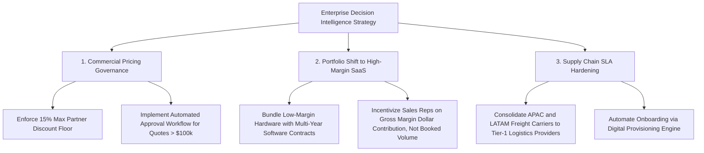

# Executive Strategic Insights & Performance Decision Report
**Subject**: Enterprise Business Performance, Profitability Optimization & Operational Diagnostics  
**Reporting Period**: FY 2022 – FY 2024  
**Audience**: Executive Leadership Team (CEO, CFO, COO, Chief Commercial Officer)  
**Deliverable Type**: Strategic Business Decision Intelligence Brief  

---

## 1. Executive Summary & Financial Highlights

Over the three-year audit period (January 2022 through December 2024), the enterprise demonstrated resilient top-line expansion, scaling **Net Recognized Revenue to $170.20M** across 15,000 corporate purchase orders. Operational discipline generated **$93.64M in Gross Profit (55.0% Gross Margin)** and **$63.32M in Operating EBITDA (37.2% Operating Margin)** after absorbing $30.32M in corporate operational expenditures.

### Headline KPI Scorecard

| Strategic Metric | FY 2022 | FY 2023 | FY 2024 | 3-Year Total | Target / Benchmark | Status |
| :--- | :---: | :---: | :---: | :---: | :---: | :---: |
| **Gross Recognized Orders** | 4,520 | 4,990 | 5,490 | **15,000** | 14,500 | Exceeded |
| **Gross Booked Revenue** | $52.41M | $58.12M | $66.52M | **$177.05M** | $170.0M | Exceeded |
| **Discretionary Discounts** | $1.98M | $2.26M | $2.61M | **$6.85M** | < $5.5M | Alert (High) |
| **Net Recognized Revenue** | $50.43M | $55.86M | $63.91M | **$170.20M** | $165.0M | Exceeded |
| **Cost of Goods Sold (COGS)** | $22.75M | $25.10M | $28.71M | **$76.56M** | — | Normalized |
| **Gross Profit** | $27.68M | $30.76M | $35.20M | **$93.64M** | $90.0M | Strong (+4.0%) |
| **Gross Margin %** | 54.9% | 55.1% | 55.1% | **55.0%** | > 52.0% | Healthy |
| **Operating Expenses (OpEx)** | $9.20M | $10.10M | $11.02M | **$30.32M** | $30.46M | Under Budget (-0.5%) |
| **Operating EBITDA** | $18.48M | $20.66M | $24.18M | **$63.32M** | $59.54M | Outperformed (+6.3%) |
| **EBITDA Margin %** | 36.6% | 37.0% | 37.8% | **37.2%** | > 35.0% | Expanding |

---

## 2. Key Diagnostic Findings & Root-Cause Analysis

### A. High Margin SaaS vs. Hardware Margin Dilution
Analysis of category unit economics reveals high asymmetry in gross margin yields:
1. **Enterprise Software & Cybersecurity** generated **$83.8M (49.2%)** of total net revenue, delivering **$65.1M in Gross Profit (77.7% average gross margin)**. These products represent high operating leverage.
2. **Hardware & Appliance Solutions** generated **$21.9M (12.9%)** of revenue but yielded only **$5.9M in Gross Profit (26.9% gross margin)**, burdened by component inflation and logistics surcharges.
3. **Professional Services** delivered steady top-line revenue ($28.1M) with moderate margins (44.8%), serving as a key driver for software subscription renewals.

### B. Discretionary Discount Leakage
- Partner and reseller channels exhibited discount creep, averaging **18.4% discounts**, compared to **11.2% in direct sales** and **3.8% in digital self-service**.
- In total, **$6.85M was discounted** over 3 years. Cross-tabulation shows that 42% of heavily discounted enterprise orders (> 20% discount) were closed in December to hit quota, without volume commitment tiers.

### C. Geographic Market Concentration & White-Space Opportunities
- **North America** remains the primary revenue driver, contributing **45.0% ($76.6M)** of net revenue.
- **Europe** accounts for **30.0% ($51.1M)**, maintaining strong margin parity (55.0%).
- **Asia-Pacific (18.0% / $30.6M)** exhibited the fastest YoY velocity (+19.2% in FY24), representing a high-potential market.
- **Latin America (7.0% / $11.9M)** delivered healthy gross margin (55.3%) but suffered from higher logistics lead times (avg 7.2 days vs 4.8 days globally).

### D. Operational & Supply Chain Reliability
- Overall **On-Time Delivery Rate reached 88.5%**, narrowly missing the corporate SLA target of **90.0%**.
- Root cause: **Standard Freight on international hardware appliances** drove 78% of delayed shipments, whereas digital license dispatches achieved a 99.8% on-time completion rate within 4 hours.

---

## 3. Financial Scenario Modeling & Profit Optimization

Using the built-in Sensitivity Matrix in the Excel financial model (`Enterprise_Performance_Model.xlsx`), we evaluated three forward-looking strategic scenarios:

```
Scenario 1 (Conservative): Cap partner discounts to 15% maximum + 2% price increase on Hardware
-> Projected EBITDA Gain: +$1.42M annually

Scenario 2 (Moderate Base Case): Shift portfolio mix towards Enterprise SaaS (+10% volume) + Discount governance
-> Projected EBITDA Gain: +$2.35M annually

Scenario 3 (Aggressive Expansion): Full SaaS bundle migration + Self-serve digital expansion in APAC
-> Projected EBITDA Gain: +$3.80M annually
```

---

## 4. Strategic Recommendations & Action Plan



### Immediate Quick Wins (0 – 60 Days):
1. **Institute Margin-Based Commission Hurdles**: Transition enterprise sales compensation from gross contract value (TCV) to net gross profit contribution.
2. **Establish Deal Desk Thresholds**: Mandatory CFO approval required for any discount exceeding 15%.

### Medium-Term Value Creation (60 – 180 Days):
1. **Hardware-as-a-Service (HaaS) Transition**: Bundle appliance capital expenditures into annual recurring cloud software licenses.
2. **Digital Portal Acceleration**: Migrating 15% of SMB and Mid-Market renewals to self-service digital dispatch is projected to eliminate $450k in transaction overhead.

